# Sigil

> Hit your reps. The weight goes up.

Sigil is a strength log for lifters who follow a program. It lines up the next workout, sets a
target for every exercise, shows its reason for each number, and adds weight when you hit the
target. The log lives on your phone first, so it works in a basement, and it is yours to export.

It is for people who train on a plan and want a quiet tool for it: no feed, no coach, no streaks.
Sigil runs on Android today. The app is built with Expo, and an iOS build is not distributed yet.

<p align="center">
  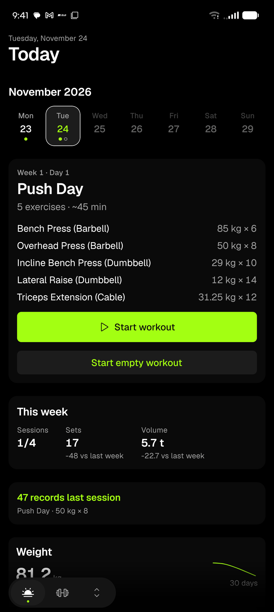
  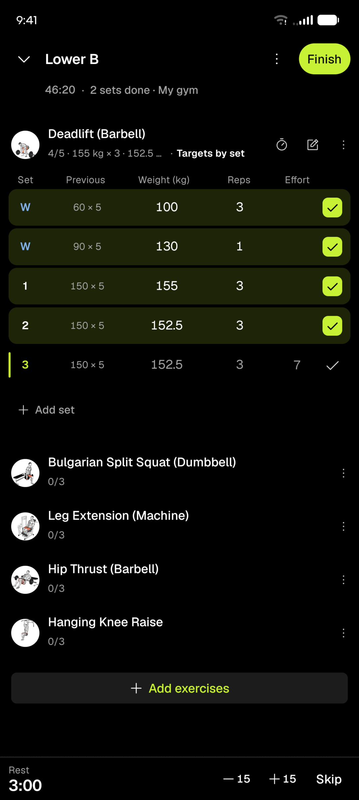
  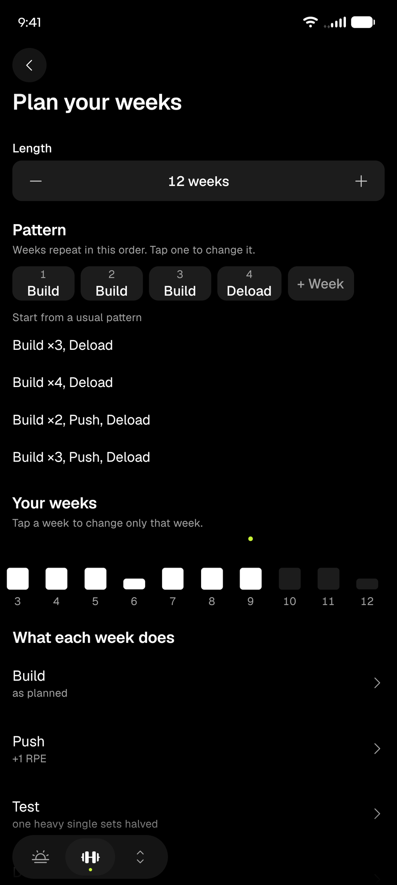
  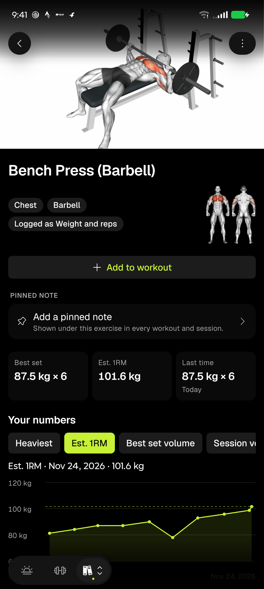
</p>

## What it does

### Plan

- **Programs.** A rotation of workouts and rest days. Home and Train show "Week 3 · Workout 2"
  and queue the next day for you. Skip a day "this time" and undo it. Pause and resume a
  program (paused days do not count). Duplicate one, give it a cover, share it as an image card.
- **Workouts.** Planned sets with weight, rep range and rest, supersets, pinned notes, and the
  muscles each workout trains on a body map. Workouts can live inside a program or on their own.
- **Plan your weeks.** Give a program a length and a repeating pattern of week phases: Build,
  Push, Test and Deload. Change one week without touching the pattern, and edit what each phase
  does. A Test week works up to a heavy single. **Deload this week** is one tap, and you can
  undo it until you start a session as the deload.

### Train

- **Live logging.** Last time's numbers sit beside each set, and grey suggestions show what to try
  today. Tick a set to complete it. Set types: warm-up, working, top set, back-off, drop, to
  failure, myo-reps. Notes, pause workout, and swap an exercise for the session or for the workout.
- **Rest timer.** Starts when you tick a set, in 15-second steps up or down, with a sound or
  vibration when rest is over. On Android a live notification shows the current set and the rest
  countdown.
- **Plates and warm-ups.** A plate calculator that knows your bars and plates, and a warm-up ramp
  added before the first working set.
- **Gyms.** Hidden until you add a second one. Each gym has a max load per machine, a load step
  and a setup note, plus what equipment it has. Suggestions snap to loads that gym can make, and
  swaps rank what the gym has first.
- **A check when a number looks wrong.** If you type 1000 kg on a 100 kg lift, mix up kg and lb, or
  put reps in the weight box, Sigil asks once: change it, keep it, or swap the fields. It never
  blocks you. The same check covers a weigh-in far off your trend, and starting a workout you
  already finished today.

### Progress

- **Progression with reasons.** Pick a rule per exercise: double progression, linear, top set with
  back-offs, or maintain. Each suggestion says why ("Add 2.5 kg and start at the bottom of the rep
  range", "This set was a grind last time. Repeat the same load and reps"). After a break it starts
  lighter. Stalls are flagged and a lighter week is offered.
- **Records and charts.** Personal records are marked the moment you set them. Every exercise gets
  a chart of estimated one-rep max, volume or best set, with its records and recent sessions.
- **Muscle volume.** Weekly sets per muscle against a target you set (Maintain, Grow, Focus or
  custom), a body map tinted by progress, and the program's own target.
- **History and reports.** Sessions grouped by week with a calendar, a monthly report and a year
  in review. Share a session, workout, program or report as an image card.
- **Exercise library.** More than 900 exercises with images and how-to steps. Filter by muscle on a
  body map, by equipment, or by what your gym has. Favourite exercises and add your own.

### Body

- **Weight.** A trend line that smooths the daily noise, a goal, and a reminder if you want one.
- **Measurements.** Track the ones you care about, in your units.
- **Photos.** Progress photos stored in a private bucket, with a slider to compare two dates.

### Your data

- **Offline first.** Every screen reads from a local SQLite database, encrypted on the device with
  SQLCipher. Changes queue while you are offline and sync through PowerSync when you are back.
- **Your record.** Export everything stored on the phone as JSON, weigh-ins and measurements as
  CSV, and finished workouts as a CSV in Strong's format.
- **Bring your history.** Import a Strong or Hevy CSV export, with a preview before anything is
  written.
- **Accounts.** Sign in with an emailed code or Google. Sign-up is by invite during the beta.
  Delete your account from Settings; the site's delete account page explains what is removed.
- **Appearance.** System, Light (pure white) or Dark (true black) with an accent: Lime, Gold,
  Ember, Rose, Ice or Mono.

## Screenshots

Dark with the Lime accent unless noted.

|                                                                                                                                               |                                                                                                                         |                                                                                                                               |                                                                                                                        |
| :-------------------------------------------------------------------------------------------------------------------------------------------: | :---------------------------------------------------------------------------------------------------------------------: | :---------------------------------------------------------------------------------------------------------------------------: | :--------------------------------------------------------------------------------------------------------------------: |
|                                                               **Home (light)**                                                                |                                                        **Train**                                                        |                                                          **Program**                                                          |                                                     **Week sheet**                                                     |
|                  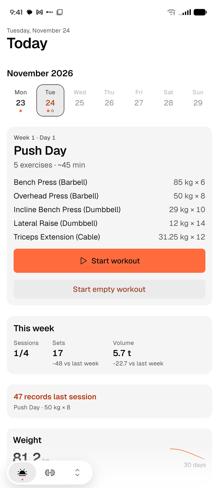                  |    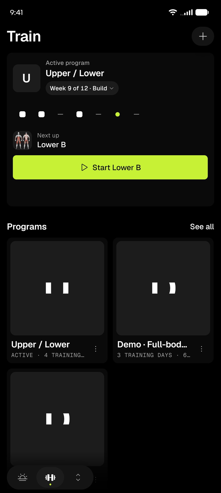    |    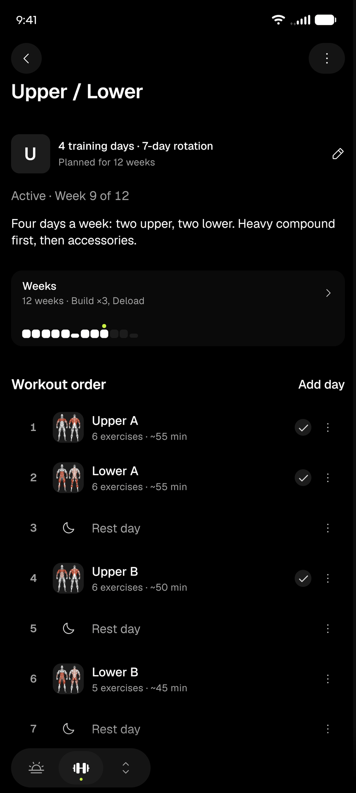     | 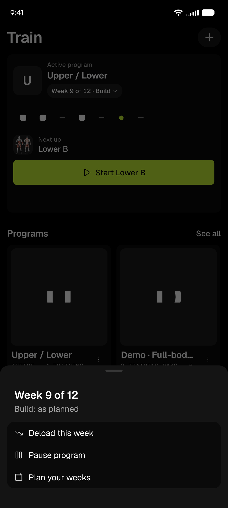  |
|                                                              **Check this set**                                                               |                                                  **Exercise library**                                                   |                                                          **History**                                                          |                                                      **Muscles**                                                       |
| 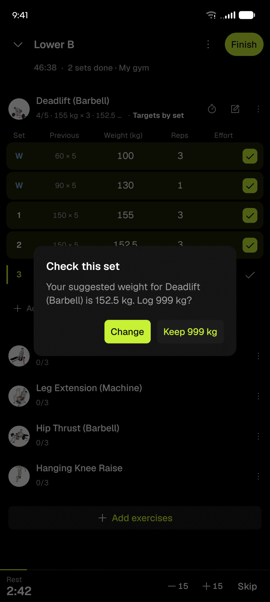 | 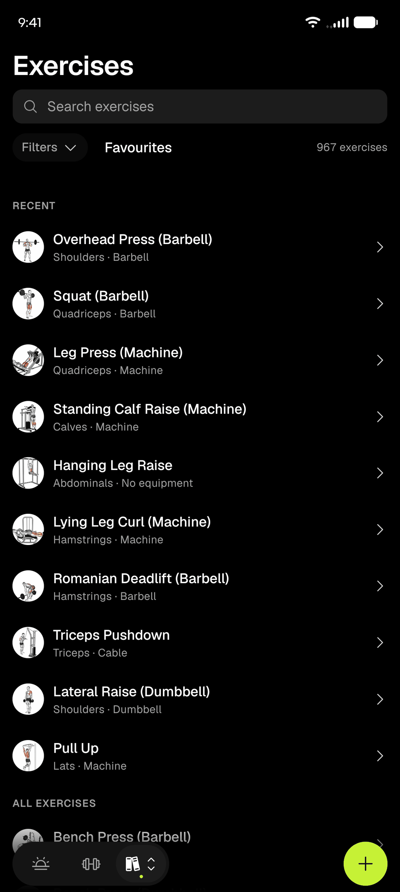 |  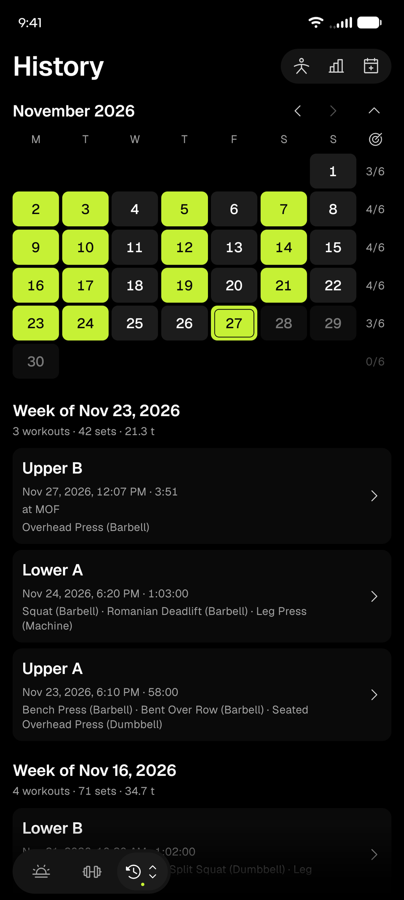   | 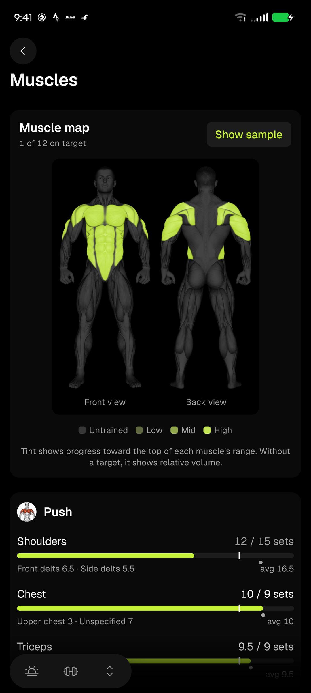 |
|                                                                **Body weight**                                                                |                                                      **Settings**                                                       |                                                   **Live session (light)**                                                    |                                                                                                                        |
| 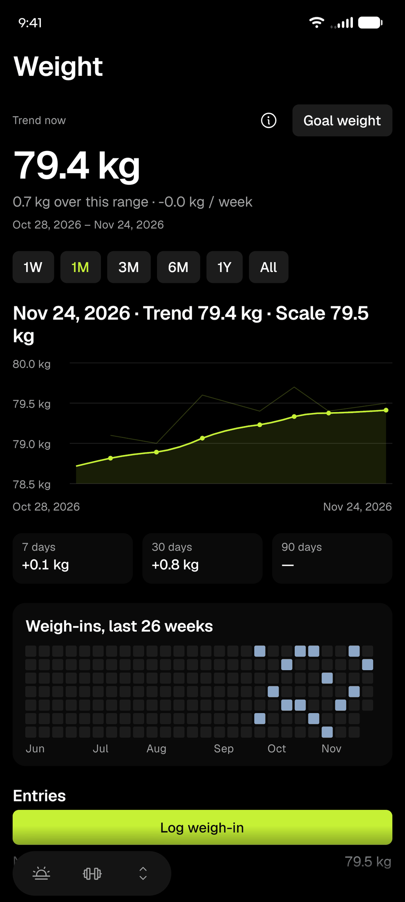 |                        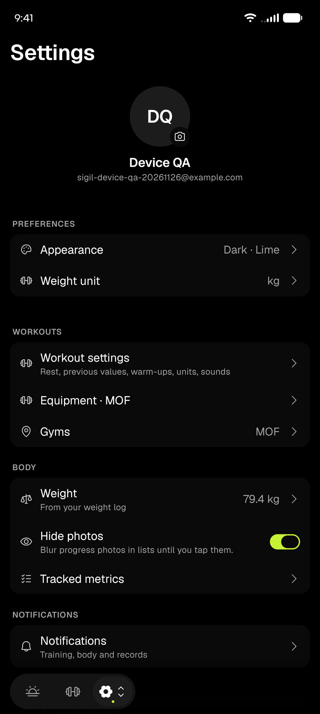                        | 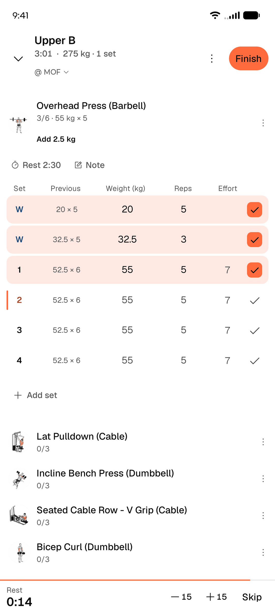 |                                                                                                                        |

## Tech stack

| Part          | Stack                                                                                              | Runs on                               |
| ------------- | -------------------------------------------------------------------------------------------------- | ------------------------------------- |
| `apps/native` | Expo, React Native, Expo Router, HeroUI Native, Uniwind (Tailwind), Reanimated, PowerSync (SQLite) | Android (EAS); iOS builds not shipped |
| `apps/server` | Hono, oRPC, Better Auth, Drizzle ORM, PostgreSQL, pg-boss jobs, React Email                        | Docker on Dokploy, behind Cloudflare  |
| `apps/web`    | TanStack Start: landing page, privacy, terms, delete account                                       | Cloudflare Workers                    |
| `packages/*`  | `@workspace/{api,auth,db,ui,env,shared,logger,i18n,email,client,sync,config}`                      |                                       |

Tooling: pnpm workspaces, Turborepo, TypeScript, oxlint and oxfmt, Vitest (API tests run against a
real Postgres in Docker), knip, lefthook, commitlint, GitHub Actions, Renovate. Architecture
decisions are recorded in [docs/adr/](docs/adr/).

### Architecture

```
 Expo app ──(oRPC over HTTPS: auth, commands)──▶ Hono API ──▶ PostgreSQL
    │                                              ▲             │
    └──(local SQLite ⇄ PowerSync sync streams)─────┼── PowerSync ◀┘ (logical replication)
                                                   └── upload queue writes validated by the API
```

## Getting started

Requires Node 24, pnpm 12 and Docker (for Postgres).

```sh
pnpm install
cp apps/server/.env.example apps/server/.env     # set BETTER_AUTH_SECRET (openssl rand -hex 32)
cp apps/native/.env.example apps/native/.env
pnpm db:start                                    # Postgres, PowerSync and MinIO (docker-compose.yml)
pnpm dev                                         # server and the native bundler
```

On a Linux host whose firewall drops container-to-host traffic, PowerSync cannot fetch the API's
JWKS and signed-in sync fails (`PSYNC_S2204`). Start the stack with the host-network override
instead of `pnpm db:start`:
`pnpm --filter server build:bootstrap && docker compose -f docker-compose.yml -f compose.linux.yml up -d --wait`.

The API listens on <http://localhost:3000>; `/api/health` answers when it is up. The native app
needs a dev client, not Expo Go: see [native development](docs/guides/native-dev.md). Without a
`RESEND_API_KEY` the server prints emails (sign-in codes) to its log. `pnpm dev:server`,
`pnpm dev:native` and `pnpm dev:web` start one app.

| Command                           | What it does                                       |
| --------------------------------- | -------------------------------------------------- |
| `pnpm lint` / `pnpm lint:fix`     | oxlint and oxfmt                                   |
| `pnpm typecheck`                  | TypeScript 7 across the workspace                  |
| `pnpm knip`                       | Dead code and unused dependencies                  |
| `pnpm test`                       | Unit and API tests (need `pnpm db:start`)          |
| `pnpm test:sync`                  | Real-service sync tests (stack and API running)    |
| `pnpm sync:bootstrap`             | Provision PowerSync roles, storage DB, publication |
| `pnpm test:sync-infra`            | Bootstrap and slot tests on the compose Postgres   |
| `pnpm i18n:check` / `i18n:report` | Locale consistency, key usage                      |
| `pnpm db:generate` / `db:migrate` | Create / apply a migration                         |

## Configuring the app

`app.config.ts` holds the app's name, URLs, ports, bundle ids, scheme and version. Nothing rewrites
derived files for you, so when you change the identity, update these by hand: the root
`package.json` name, the compose project, database and volume names in `docker-compose.yml`, the
port in `apps/server/Dockerfile`, the server URLs in `apps/native/eas.json`, and the `.env.example`
files. Workspace packages stay `@workspace/*` on purpose. Deployment is in
[docs/deployment.md](docs/deployment.md). The repository keeps its old name, vermillion.

## Documentation

| Read                                                             | For                                                                 |
| ---------------------------------------------------------------- | ------------------------------------------------------------------- |
| [AGENTS.md](AGENTS.md) and [.agents/](.agents/)                  | Conventions for coding agents and contributors                      |
| [CONTEXT.md](CONTEXT.md)                                         | Glossary                                                            |
| [docs/adr/](docs/adr/)                                           | Why each major decision was made                                    |
| [DESIGN.md](DESIGN.md)                                           | Brand tokens                                                        |
| [docs/guides/native-dev.md](docs/guides/native-dev.md)           | Dev client, local services on a phone                               |
| [docs/deployment.md](docs/deployment.md)                         | Dokploy, Cloudflare DNS, firewall, trusted proxies, env, EAS        |
| [docs/runbook.md](docs/runbook.md)                               | Deploy, rollback, backups, restore drill, secrets, closing sign-ups |
| [docs/guides/android-release.md](docs/guides/android-release.md) | Signed APK builds on GitHub Actions and GitHub Releases             |
| [docs/privacy-readiness.md](docs/privacy-readiness.md)           | The privacy checklist behind the site's policy                      |

## License

No license is granted yet: set one before publishing a fork. Third-party notices:
[THIRD_PARTY_NOTICES.md](THIRD_PARTY_NOTICES.md).

## Photo credit

The retired Sigil sign-in and website photograph was an edited crop and colour grade of
[Michelangelo’s Atlas Prisoner](https://commons.wikimedia.org/wiki/File:%27Atlas_Slave%27_by_Michelangelo_-_JBU_02.jpg)
by Jörg Bittner Unna, licensed under [CC BY-SA 3.0](https://creativecommons.org/licenses/by-sa/3.0/).
Only its archived source remains, in `docs/design/sigil/source/`; the app and site no longer show it.
