# Vermillion

**An offline-first strength-training app for Android and iOS.** Build programs, log workouts live with rest timers and plate math, browse a 450+ exercise library with a muscle body map, and keep everything in sync across devices, even with no signal in the gym.

Built with Expo / React Native on the client and Hono + oRPC + PostgreSQL on the server, with local-first sync through PowerSync.

<p align="center">
  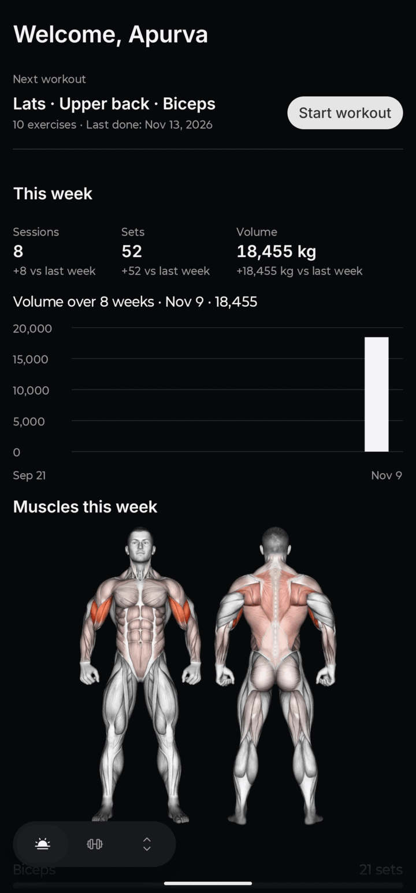
  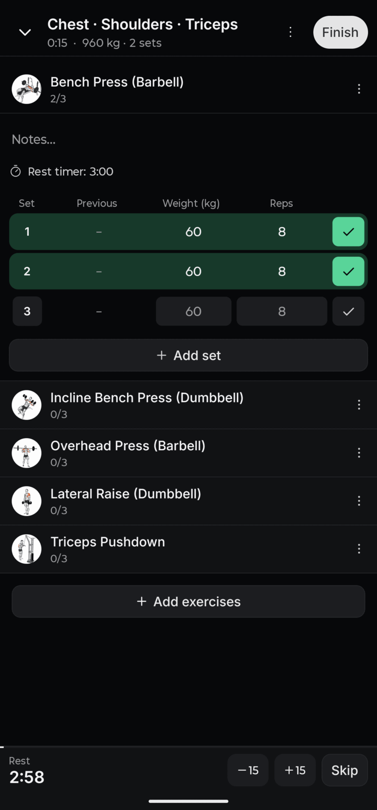
  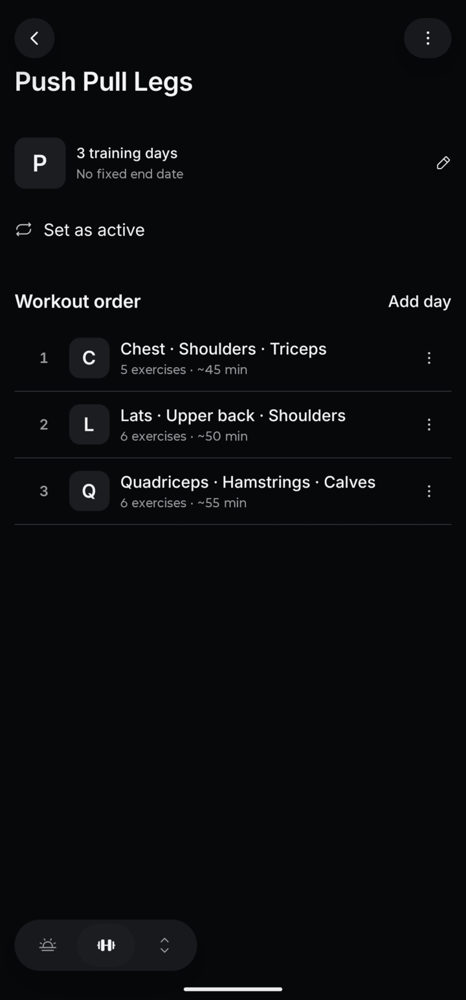
  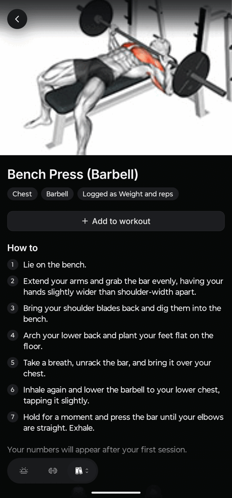
</p>

## Features

- **Programs and workouts:** multi-day programs with a rotation order, planned sets (weight, rep ranges, rest) and a workout editor that shows the muscles trained on a body map.
- **Live session logging:** previous-session "ghost" values, one-tap set completion, set kinds (warm-up, drop, failure), a rest timer with ±15 s controls, rest notifications and sounds, and an Android live notification with in-notification actions.
- **Progress:** weekly sessions, sets and volume, an 8-week volume chart, muscles-trained heat map, personal records and progressive-overload suggestions.
- **Exercise library:** 450+ exercises with images, how-to steps, muscle and equipment filters, plus custom exercises.
- **Offline-first:** every screen reads from a local SQLite database synced with PowerSync; writes queue while offline and upload when back online, with a review screen for rejected writes.
- **Accounts:** passwordless email-code sign-in and passkeys, Google/GitHub OAuth, Turnstile CAPTCHA, rate limiting, disposable-email blocking and account deletion.
- **Themes:** five hand-tuned palettes (Classic, Chalk, Frost, Iron, Dusk), each in light and dark.

## Screenshots

|                               Home                                |                         Home (Frost theme)                         |                                   Train                                   |                              Program                               |
| :---------------------------------------------------------------: | :----------------------------------------------------------------: | :-----------------------------------------------------------------------: | :----------------------------------------------------------------: |
|             | 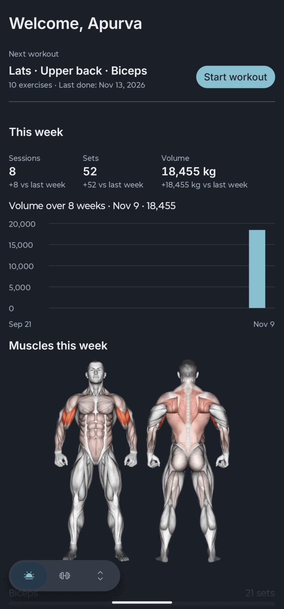 |          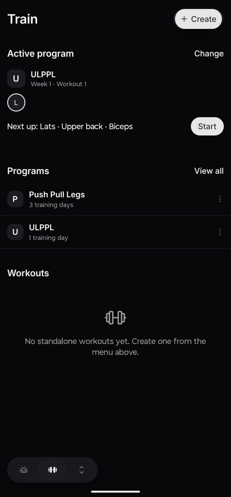          |    |
|                            **Workout**                            |                         **Workout editor**                         |                             **Live session**                              |                        **Exercise library**                        |
| 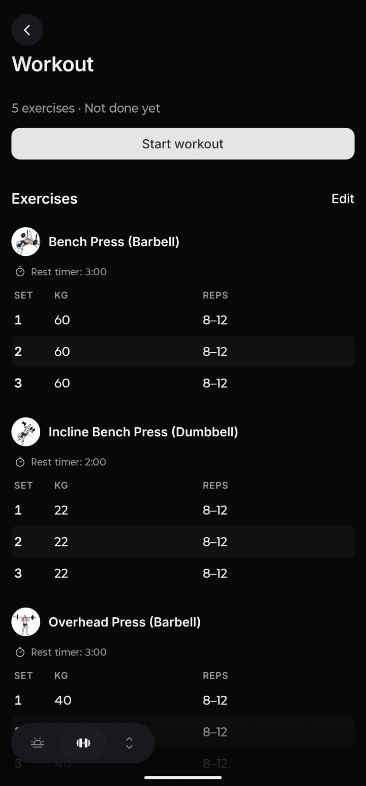  |  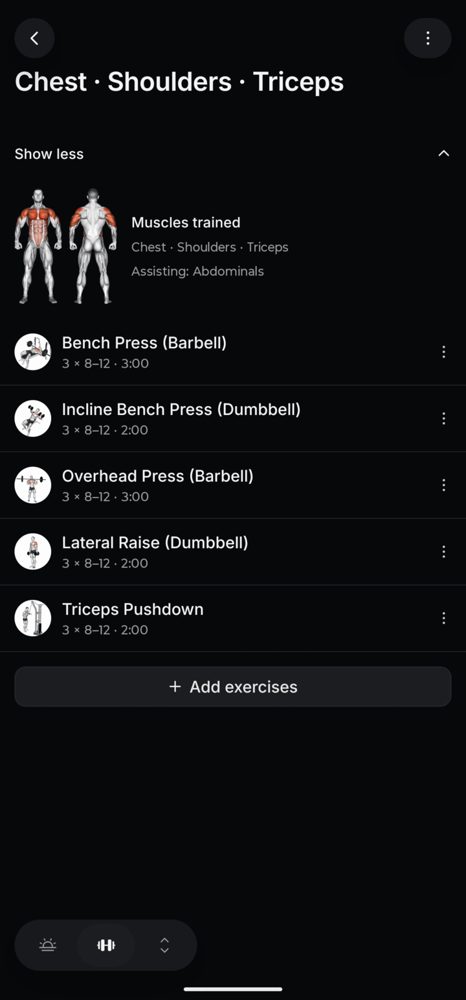  |  | 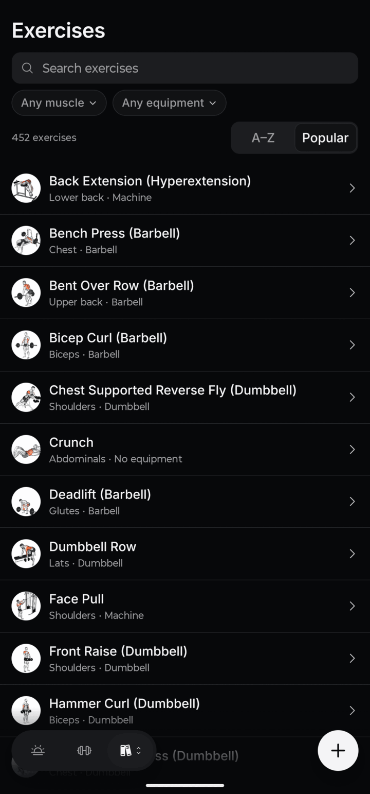 |
|                        **Exercise detail**                        |                             **Themes**                             |                               **Settings**                                |                                                                    |
|  |   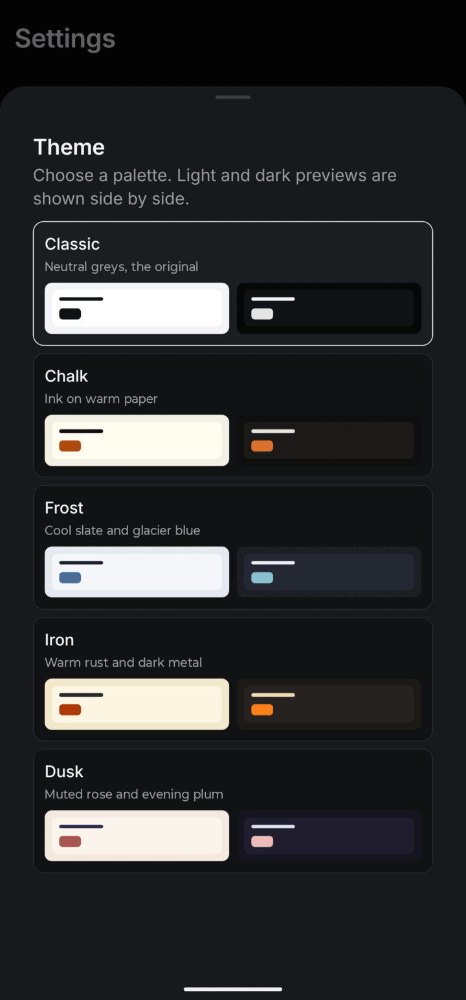   |        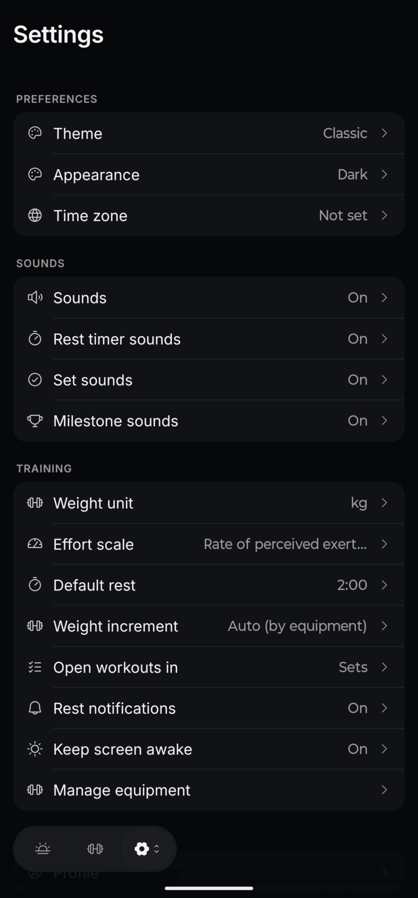         |                                                                    |

## Tech stack

| Part          | Stack                                                                                              | Runs on                              |
| ------------- | -------------------------------------------------------------------------------------------------- | ------------------------------------ |
| `apps/native` | Expo, React Native, Expo Router, HeroUI Native, Uniwind (Tailwind), Reanimated, PowerSync (SQLite) | iOS and Android (EAS)                |
| `apps/server` | Hono, oRPC, Better Auth, Drizzle ORM, PostgreSQL, pg-boss jobs, React Email                        | Docker on Dokploy, behind Cloudflare |
| `packages/*`  | `@workspace/{api,auth,db,ui,env,shared,logger,i18n,email,client,sync,config}`                      |                                      |

Tooling: pnpm workspaces, Turborepo, TypeScript, oxlint and oxfmt, Vitest (175 test files, run against real Postgres in Docker), knip, lefthook, commitlint, GitHub Actions, Renovate. Architecture decisions are recorded in [docs/adr/](docs/adr/) (39 ADRs).

### Architecture

```
 Expo app ──(oRPC over HTTPS: auth, commands)──▶ Hono API ──▶ PostgreSQL
    │                                              ▲             │
    └──(local SQLite ⇄ PowerSync sync streams)─────┼── PowerSync ◀┘ (logical replication)
                                                   └── upload queue writes validated by the API
```

## Getting started

Requires Node 24, pnpm 12 and Docker (for Postgres).

```sh
pnpm install
cp apps/server/.env.example apps/server/.env     # set BETTER_AUTH_SECRET (openssl rand -hex 32)
cp apps/native/.env.example apps/native/.env
pnpm db:start                                    # Postgres, sync bootstrap and PowerSync (docker-compose.yml)
pnpm dev                                         # server and the native bundler
```

On a Linux host whose firewall drops container-to-host traffic, PowerSync cannot fetch the API's JWKS and signed-in sync fails (`PSYNC_S2204`). Start the stack with the host-network override instead of `pnpm db:start`: `pnpm --filter server build:bootstrap && docker compose -f docker-compose.yml -f compose.linux.yml up -d --wait`.

The API listens on <http://localhost:3000>; `/api/health` answers when it is up. The native app needs a dev client, not Expo Go: see [native development](docs/guides/native-dev.md). Without a `RESEND_API_KEY` the server prints emails (sign-in codes) to its log. `pnpm dev:server` and `dev:native` start one app.

| Command                           | What it does                                       |
| --------------------------------- | -------------------------------------------------- |
| `pnpm lint` / `pnpm lint:fix`     | oxlint and oxfmt                                   |
| `pnpm typecheck`                  | TypeScript 7 across the workspace                  |
| `pnpm knip`                       | Dead code and unused dependencies                  |
| `pnpm test`                       | Unit and API tests (need `pnpm db:start`)          |
| `pnpm test:sync`                  | Real-service sync tests (stack and API running)    |
| `pnpm sync:bootstrap`             | Provision PowerSync roles, storage DB, publication |
| `pnpm test:sync-infra`            | Bootstrap and slot tests on the compose Postgres   |
| `pnpm i18n:check` / `i18n:report` | Locale consistency, key usage                      |
| `pnpm db:generate` / `db:migrate` | Create / apply a migration                         |

## Configuring the app

`app.config.ts` holds the app's name, URLs, ports, bundle ids, scheme and version. Nothing rewrites derived files for you, so when you change the identity, update these by hand: the root `package.json` name, the compose project, database and volume names in `docker-compose.yml`, the port in `apps/server/Dockerfile`, the server URLs in `apps/native/eas.json`, and the `.env.example` files. Workspace packages stay `@workspace/*` on purpose. Deployment is in [docs/deployment.md](docs/deployment.md).

## Documentation

| Read                                            | For                                                                 |
| ----------------------------------------------- | ------------------------------------------------------------------- |
| [AGENTS.md](AGENTS.md) and [.agents/](.agents/) | Conventions for coding agents and contributors                      |
| [CONTEXT.md](CONTEXT.md)                        | Glossary                                                            |
| [docs/adr/](docs/adr/)                          | Why each major decision was made                                    |
| [docs/deployment.md](docs/deployment.md)        | Dokploy, Cloudflare DNS, firewall, trusted proxies, env, EAS        |
| [docs/runbook.md](docs/runbook.md)              | Deploy, rollback, backups, restore drill, secrets, closing sign-ups |
| [DESIGN.md](DESIGN.md)                          | Brand tokens                                                        |

## Marketing site and companion app

Both are future, separate apps that call the same API (`packages/api` exports its types) and, for the companion, the same sync data. Nothing in the repo is shaped around them except keeping the server client-agnostic.

## License

No license is granted yet: set one before publishing a fork. Third-party notices: [THIRD_PARTY_NOTICES.md](THIRD_PARTY_NOTICES.md).
